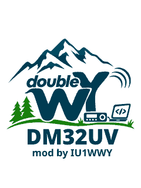
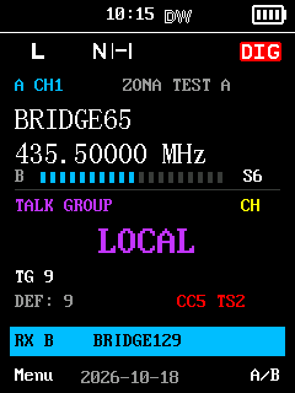
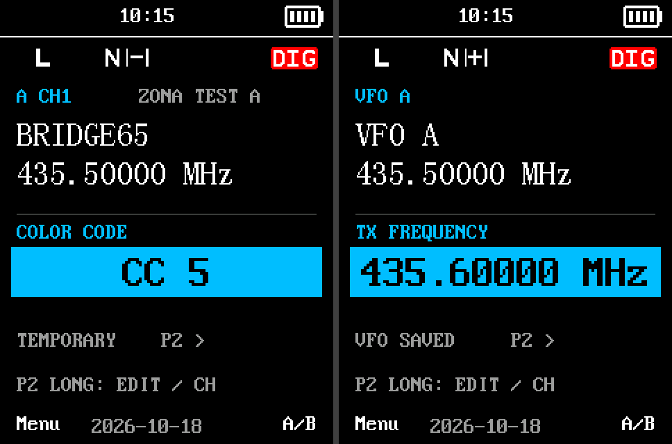
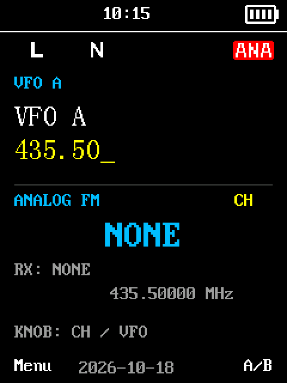
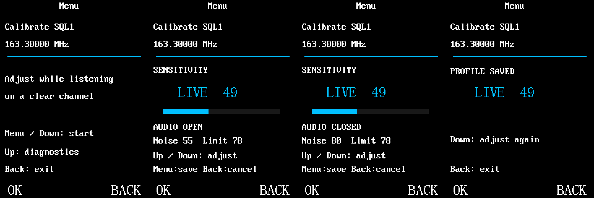
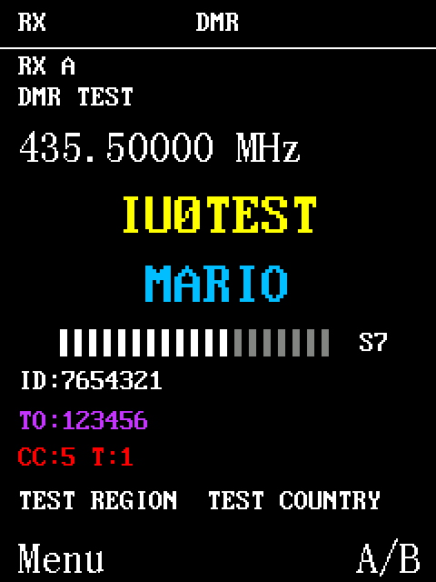
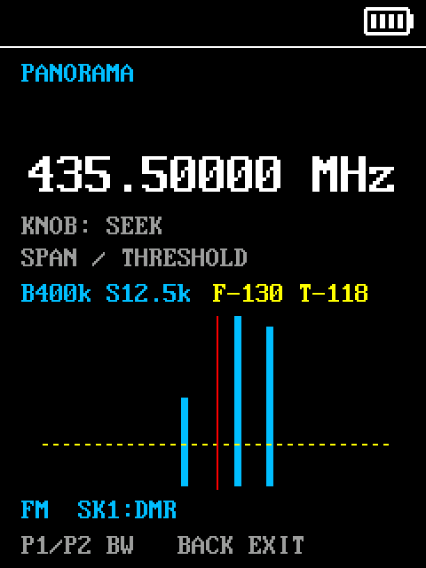
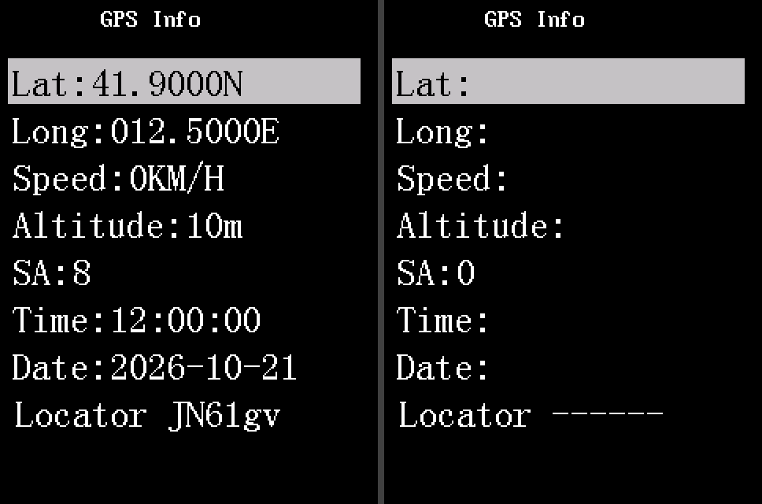
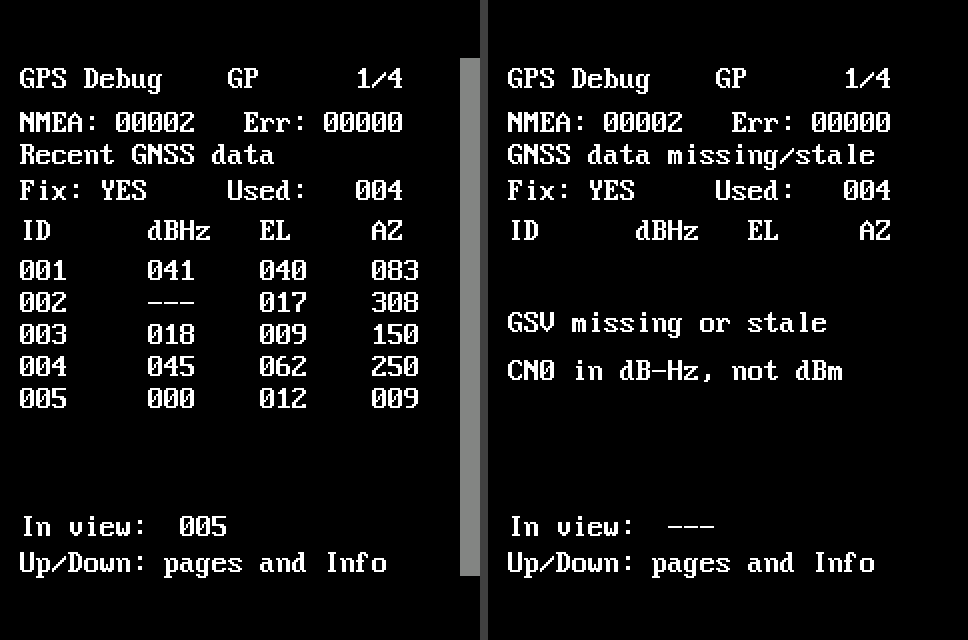
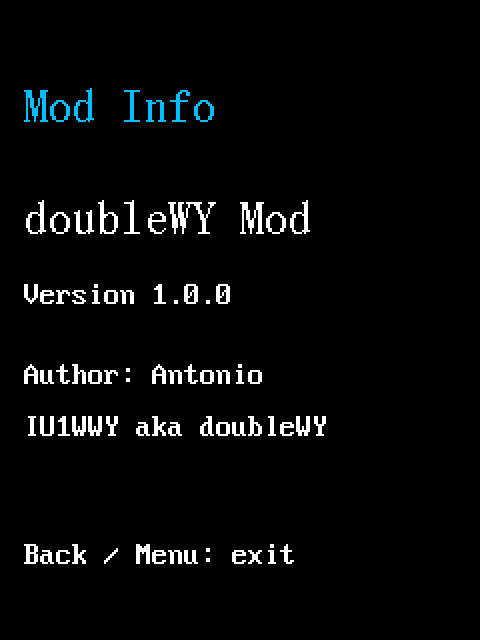

# doubleWY Mod for Baofeng DM32UV — Guide

The **doubleWY Mod** was created by **IU1WWY**, a radio amateur with a
passion for computing, to improve the Baofeng DM32UV original firmware: fix
its defects, make everyday use easier and add new features over time. It is
not an official Baofeng product.

This guide always describes the current state of the mod. It complements the Baofeng DM32UV OEM manual (`DM32.NRF.01.049`)
and describes **every feature, improvement and fix** of the mod. OEM
functions not mentioned keep their behaviour. P1/P2, SK1/SK2, Up/Down, Menu
and Back are the physical keys.

Screenshots are produced by executing the firmware's own drawing code with
the OEM fonts and **fictional data** (names, IDs, frequencies); on the radio
colours and content depend on your codeplug and real signals.

## Contents

1. [Power-on, keys and backlight](#1-power-on-keys-and-backlight)
2. [A/B main screen and S-meter](#2-ab-main-screen-and-s-meter)
3. [Quick editor: DMR contacts, tones, CC/TS/TX](#3-quick-editor-dmr-contacts-tones-cctstx)
4. [Analog/Digital with `*` and DMR Monitor](#4-analogdigital-with--and-dmr-monitor)
5. [Squelch: quick adjust and Calibrate SQL1](#5-squelch-quick-adjust-and-calibrate-sql1)
6. [Zones, All Zones and Scan](#6-zones-all-zones-and-scan)
7. [DMR QSO page](#7-dmr-qso-page)
8. [Panorama](#8-panorama)
9. [GPS: Info with locator and GPS Debug](#9-gps-info-with-locator-and-gps-debug)
10. [Bands and language](#10-bands-and-language)
11. [Mod Info](#11-mod-info)
12. [Fixes included](#12-fixes-included)
13. [Installing and updating](#13-installing-and-updating)

## 1. Power-on, keys and backlight

> **In short:** The radio powers on faster, shows the doubleWY logo and keeps responding to keys while receiving.

- **Boot screen.** At power-on the doubleWY "DM32UV – mod by IU1WWY" logo
  is shown for 1.5 seconds on a white background instead of the OEM screen
  (the Boot screen setting no longer applies).
- **Fast power-on.** Fixed waits in the OEM initialisation are
  reduced: about 0.35 s of waiting before the screen lights up instead of
  about 2 s. The remaining time depends on bootloader and hardware. Nothing
  to configure.
- **Keys during receive.** Keys work while the radio is receiving. Keypad
  lock and OEM transmit checks still apply.
- **Backlight during Scan.** The backlight timer keeps counting during scan;
  a reception or a key press turns it back on as in the OEM firmware.

## 2. A/B main screen and S-meter

> **In short:** A clearer main screen: what you are listening to in the centre, the other side in a card and a compact S-meter.

- The centre shows the useful identity: memory name or VFO, frequency,
  contact/tone. The other side sits in a compact card (memory name or VFO
  frequency).
- The light-blue **RX A/B** card signals a reception on the other side
  without changing the selected side.
- **Compact S0–S9/9+ meter** with A/B letter: idle it follows the selected
  side; in dual, during a reception, the side being heard; in TX and Scan the
  selected side. The RSSI scale is indicative, not calibrated in dBm.
- Fields refresh individually: no full redraws while idle and
  no rewriting of the S-meter with identical values.
- OEM states (N, Monitor, time/date, AM) are kept; a disabled tone shows as
  **NONE**.

## 3. Quick editor: DMR contacts, tones, CC/TS/TX

> **In short:** Long P2 changes DMR contact, TX tone, Color Code, Time Slot and TX frequency on the fly, without the CPS.

| Command | Action |
| --- | --- |
| **Long P2** | Opens the editor: DMR contact or analog TX tone |
| **Knob** in the editor | Changes the highlighted field |
| **Short P2** in DMR | Contact → CC → TS → TX → contact |
| **Short P2** in analog | TX tone → TX → TX tone |
| **Back** | Closes the editor |
| **Short P1/P2** outside the editor | CPS functions unchanged, including zones |

- **DMR contacts**: CPS order, group and private calls, independent choice
  for A and B. **DEF** is the codeplug TX contact. A chosen group joins the
  temporary RX filter (OEM capacity 32 entries); a private call does not.
- **Analog TX tones**: OFF, 50 CTCSS and 105 DCS per polarity (261 choices).
  Only the **TX** tone changes; the RX tone stays as configured.
- **TX frequency**: 100 kHz step, RX unchanged. Starts from the configured TX,
  or from RX if missing.
- **VFO numeric entry**: the typed frequency appears in yellow in the same
  layout.

| Field changed | Memory | VFO |
| --- | --- | --- |
| DMR contact, TX tone | Temporary | Temporary |
| CC, TS, TX frequency | Temporary | Saved in the VFO |
| Analog/Digital type with `*` | Saved in the memory | Saved in the VFO |
| Monitor chosen in the CC field | Temporary, shared by both sides | Temporary, shared |
| Analog SQL (SK1+Up/Down) | Saved on release | Saved on release |

Temporary choices do not rewrite the codeplug and are cleared when you change
memory/frequency, with Scan, Panorama or on restart.

## 4. Analog/Digital with `*` and DMR Monitor

> **In short:** The `*` key toggles analog/digital; DMR Monitor hears all traffic without CC/TS filters.

- **`*` on the main screen** toggles Analog/Digital on the selected side, once
  per press (even a long one), and saves the type in the memory or VFO. It
  replaces the NOAA action; if a side was left in NOAA, the first press
  returns it to normal mode.
- In the **CC** field the knob cycles **CC0…CC15 → MONITOR → CC0**. Monitor
  enables the OEM DMR listening that ignores CC/TS, without changing the
  configured ones; picking a numeric CC turns it off. Shown as
  **MON CC/TS:\***.
- Switching a **VFO** to Digital (with `*`, MR/VFO or A/B) enables Monitor by
  default; the physical key turns it off or on and all indicators stay in
  sync. Going back to Analog disables it. Memories do not enable it
  automatically.

## 5. Squelch: quick adjust and Calibrate SQL1

> **In short:** Squelch adjustable on the fly with SK1 + Up/Down, and SQL1 tuning by ear, saved per band.

**Quick adjust (analog).** Hold **SK1** and press **Up/Down** to change SQL
on the selected side; the level appears in small digits and is saved once on
release, without triggering the short SK1 Scan function. DMR squelch is not
changed.

**Calibrate SQL1** (Menu → Calibrate SQL1, sliders icon) sets the SQL1 noise threshold by
ear on a clear frequency, in FM, from memory or VFO.

1. Select frequency and side, FM with SQL1.
2. **Menu** or **Down** starts adjusting from the applicable saved profile
   (also interpolated), otherwise from 1.
3. **Up** increases selectivity, **Down** decreases it; stop when the hiss
   disappears and check that voice still passes.
4. **Menu** saves; **Back** before saving cancels and restores.
5. **Live 0 + Menu** removes the profile and returns to the OEM criterion (not
   SQL0). **Up** from the intro opens diagnostics (R/N, thresholds, H/S/RX)
   without saving.

The profile applies per band and Wide/Narrow and can affect nearby
frequencies, also on the other side or between memory and VFO. It does not
appear in the CPS: a CPS rewrite of the calibration may erase it, and going
back to an earlier firmware does not erase it. During tuning the RX tone is
bypassed and dual watch suspended. The 90 CPS thresholds and SQL2–9 are not
touched. The value is not a dBm measurement. The computed
threshold is reused while the context is unchanged and the live screen
updates only changed fields.

## 6. Zones, All Zones and Scan

> **In short:** Numbered zones merged into a group, a virtual zone with every channel and a clearer, more reliable Scan.

**Merged zones.** Adjacent zones with the same prefix and consecutive number
(e.g. Zone1, Zone2, Zone3) form one group: knob, zone change and Scan
(without an assigned scan list) go through all of them. Names without a
number, leading zeros, different prefixes or gaps break the group. CH entry
and the Zone menu stay on physical zones.

**All Zones** is the first entry of the Zone menu (confirm it to enable it)
and precedes normal zones in the Zone cycle: "previous" from the first zone,
or "next" from the last. With All the knob walks every channel in CPS order
and Scan scans them all, ignoring scan lists; empty zones skipped, duplicate
channels repeated. The choice is independent for A/B and lasts for the
session. Confirming a physical zone from the menu leaves All.

**Memory scan**
- While searching the screen shows **SCAN + zone name** (or **SCAN All
  Zones**) with the Scan icon; on reception, the received channel.
- **Back** on a reception stops Scan on that memory.
- **Nuisance Delete** excludes the channel (in every zone where it appears)
  and returns at once to the search view. Up to 11 distinct IDs per
  group/All scan session; the twelfth exclusion is refused.
- **RX tone**: with Monitor off, if the memory has an RX CTCSS/DCS,
  audio follows the tone decoder. A short stop on a carrier can still occur.
- In All Zones the search keeps the current zone instead of restarting from
  the first each time.

**VFO scan**
- Uses the OEM range and step of the selected VFO; VFO A/B title with the
  frequency updated at each step and the Scan icon.
- Listening on the other side is suspended during the scan and restored on
  stop; nothing is saved. **Back** removes the icon at once.

## 7. DMR QSO page

> **In short:** During a DMR QSO you see the caller's callsign and name in large type, with ID, destination and country.

- Large callsign (yellow) and name (light blue); destination **TO** purple,
  **CC/TS** red; DMR ID always visible; channel/zone and frequency remain.
- Identity comes from the **DMR database**, which takes precedence over the
  contact name. If the database lacks the ID, a valid enabled **Talker
  Alias** is used (first 15 bytes, split at the first space); otherwise only
  the ID.
- The bottom line **always shows region/country** from the database;
  it is empty when the ID is not in the database.
- Missing data is never invented; long or non-ASCII text may use the small
  OEM font.

## 8. Panorama

> **In short:** A spectrum view on the VFO: see signals around the frequency, seek them with the knob and listen.

Open **Menu → Panorama** (bar-graph icon). It uses the selected VFO, also
starting from dual, and suspends the other side until exit. When the selected
side is a memory the entry is not shown: switch to VFO first.

| Command | Action |
| --- | --- |
| **P1 / P2** | Narrows / widens the span |
| **Up / Down** | Lowers / raises floor and threshold, 1 dB step |
| **Knob** | Seeks the next signal above threshold, checks the peak and listens |
| **Click past the edge** | Adjacent page (centre ± span) |
| **SK2** | Seek/listen or resume the sweep |
| **Short SK1** | Toggles FM and DMR (temporary OEM Monitor) |
| **Back** | Exits, restores the context and saves the shown frequency to the VFO |

- 33 columns; wider spans aggregate more points per column. Raster 7.5 kHz
  VHF and 12.5 kHz UHF; maximum span 30.72 MHz VHF or 51.2 MHz UHF, within
  band limits.
- The dashed line **T = F + 12 dB** is the audio threshold: if the peak is
  below it, lower it with Up. Seeking is muted in FM; listening uses the
  chosen mode.
- DMR uses the OEM Monitor (no CC/TS filter).
- Back restores FM/DMR, Monitor and dual; only the frequency is saved, with
  OEM TX offset. A forced exit (context change, TX) does not save. Menu and
  other configured keys are ignored while the graph is active.

## 9. GPS: Info with locator and GPS Debug

> **In short:** GPS Info also shows the Maidenhead locator; GPS Debug explains what the GPS module receives, satellite by satellite.

**GPS Info** shows a six-character Maidenhead **Locator** line (e.g.
`JN61gv`) computed from the position; without a fix `------`. The page
refreshes by itself as data arrives. No settings are saved.

From GPS Info press **Up or Down** for **GPS Debug**. Up/Down cycle
GP1..4, BDS1..4, GN1..4 and return to Info; Up from GP1 returns to Info;
Back as OEM.

- **GP**, **BDS**, **GN**: GPS, BeiDou and mixed GSV messages. GN may repeat
  satellites from the others: do not add the totals.
- Each group: 4 pages × 8 rows = 32 list positions (not IDs 1–32).

| Column | Meaning |
| --- | --- |
| ID | Satellite identifier reported by the module |
| dBHz | C/N0, signal quality in dB-Hz; not dBm, not accuracy |
| EL | Elevation: 0° horizon, 90° overhead |
| AZ | Azimuth from north: 0° N, 90° E, 180° S, 270° W |

`---` = not available (not zero).

- **NMEA**: messages with valid checksum; **Err**: bad checksums or rejected
  GSV. Counters for this power-on, modulo 65536.
- **Recent / missing-stale data**: data arriving from the module, not RF power.
- **Fix YES/NO** and **Used**: OEM values; they may stay old if the stream
  stops. **In view**: total for the current group. **Partial**: incomplete
  GSV cycle. Old data is hidden.
- While GPS Debug is open GSV output is requested temporarily; no settings
  are saved and the receiver is not reset.

Reading it: rising NMEA means messages arrive, not that there is a fix.
Rising NMEA without GSV may depend on the module and does not prove an
antenna fault. Satellites with C/N0 and Fix NO: signals present, position not
yet valid. Rising Err: corrupted or rejected messages.

## 10. Bands and language

> **In short:** Available receive and transmit bands, and menus fully in Italian or English.

- RX 136–174 and 400–480 MHz, AM 108–136 MHz; TX 136–174 and 400–480 MHz.
  Limits applied in RAM, calibration untouched; edge performance not
  measured. Broadcast FM radio unchanged.
- **Italian language.** The language menu offers **Italian** and
  **English**: Italian replaces the OEM Chinese in menus, settings, messages
  and pages such as GPS Info. No accented letters; some entries are
  abbreviated to fit the display.
- With **English** OEM menus and new labels are English. Channel, zone,
  contact and database names are your own.

## 11. Mod Info

> **In short:** A menu page showing the installed mod version and its author.

**Menu → Mod Info** ("i" icon) shows the mod name and version and the
author: Antonio, IU1WWY aka doubleWY. **Back** or **Menu** return to the main
screen. It always shows the installed version: handy to check an update.

## 12. Fixes included

> **In short:** Original firmware defects fixed by the mod.

| Issue | Fix |
| --- | --- |
| Keys ignored during receive | Keys active during RX |
| Backlight always on during Scan | Backlight timer runs during Scan |
| Channel name missing during DMR RX | Received channel name shown |
| Limited zone scan | Zones up to 64 positions, merged zones, All Zones |
| Search title not restored after Nuisance Delete | Restored immediately |
| Frozen VFO scan display, icon left after Back | Frequency follows, icon removed |
| Other A/B side disturbing VFO scan | Suspended during scan, restored on stop |
| Start-up channel at 0 MHz until first knob click | Loaded correctly at start |
| Wrong memory/VFO context in calibration | A/B and context recomputed |
| Identical S-meter redraws (possible ticking) | Drawn only on change |
| GPS Info not refreshing automatically | Automatic refresh restored |
| RX tone forced open in memory scan | OEM CTCSS/DCS decoder respected |
| Talker Alias replacing region in QSO | Line always region/country |
| Slow power-on | Fixed waits reduced |
| Menus only in Chinese or English | Chinese replaced by Italian |

## 13. Installing and updating

> **In short:** The `doublewy_patcher.py` script reads the firmware from your radio, builds the mod and installs it, guiding you step by step. It works on Windows, macOS and Linux.

### What you need

- A DM32UV with firmware **DM32.NRF.01.049** (Menu → Settings → Radio info)
  or with a published doubleWY Mod version.
- A charged battery: a power loss while writing leaves the radio without
  firmware (recoverable, but better avoided).
- The DM32UV USB programming cable (**CH340** converter).
- **Python 3.8 or newer** and the **pyserial** module.
- No other program using the cable: close the Baofeng CPS and any browser tab
  with grid.radio.

### Windows

1. Download Python from <https://www.python.org/downloads/> and install it
   ticking **"Add python.exe to PATH"**.
2. Open **Command Prompt** and install pyserial: `py -m pip install pyserial`
3. Connect the cable. **Device Manager → Ports (COM & LPT)** must show
   *USB-SERIAL CH340 (COMx)*. If not, install the CH340 driver from the
   manufacturer WCH (<https://www.wch-ic.com/downloads/CH341SER_EXE.html>) and
   reconnect the cable.
4. In the folder containing `doublewy_patcher.py` run:
   `py doublewy_patcher.py`

### macOS

1. Install Python from <https://www.python.org/downloads/macos/> (or with
   Homebrew: `brew install python`).
2. In **Terminal**: `python3 -m pip install pyserial`
3. Connect the cable: recent macOS versions recognise the CH340 by themselves;
   the port is `/dev/cu.usbserial-…` or `/dev/cu.wchusbserial…`. If it does not
   appear, install WCH's CH34x macOS driver and restart.
4. In the script folder: `python3 doublewy_patcher.py`

### Linux

1. Python is almost always installed. Install pyserial from your package
   manager (`sudo apt install python3-serial`, `sudo pacman -S python-pyserial`,
   `sudo dnf install python3-pyserial`) or with
   `python3 -m pip install --user pyserial`.
2. Connect the cable: the port is `/dev/ttyUSB0`. Your user must be allowed to
   use it: add it to the `dialout` (Debian/Ubuntu/Fedora) or `uucp` (Arch)
   group, e.g. `sudo usermod -aG dialout $USER`, then log out and back in.
3. In the script folder: `python3 doublewy_patcher.py`

### The guided procedure

1. **Language and port.** Choose Italian or English; the script lists the USB
   ports and proposes the CH340 cable.
2. **Reading (step 1/3).** Turn the radio off, press Enter, then **turn it on
   normally**. The screen stays off: the radio is in the processor's boot mode
   and the script reads the whole program memory (1 MB, about 2 minutes, with a
   progress bar). The backup is saved as `DM32UV-program-memory-DATE.bin`:
   **keep it**, it holds your radio's original firmware and lets you go back.
3. **Detection.** The script recognises the original 049 or the installed mod
   version and builds `doubleWY-mod-DM32UV-vX.Y.Z.bin`. If the radio already has
   the current version it says so and asks whether to reinstall.
4. **Update mode (step 2/3).** Turn the radio off, hold **SK1** (side key) and
   **PTT** and turn it on: the LED turns green. Release the keys and confirm
   with `y`.
5. **Installing (step 3/3).** Erase (about 15 s) and write (about 100 s) with a
   progress bar. If the radio is not in update mode the script stops
   **before** erasing anything.
6. Turn the radio off and on: the doubleWY splash appears and Menu → Mod Info
   shows the installed version.

### Other ways to use it

- Only build the file, no radio connected:
  `python3 doublewy_patcher.py --firmware backup.bin` (accepts the
  program-memory backup, the original 049 update file or a published mod). The
  file can also be installed with the Baofeng CPS.
- Install an existing file or repeat an interrupted installation:
  `python3 doublewy_patcher.py --firmware backup.bin --flash`.

### Updating and going back

- **New mod version:** download the new `doublewy_patcher.py` and repeat the
  procedure: it detects the installed version and applies only what is needed.
- **Back to the original firmware:** use the backup saved the first time; the
  original 049 is rebuilt from its program memory and can be installed with the
  Baofeng CPS or a program-memory writer.
- The bootloader is never modified. Going back does not undo data already
  saved (VFO frequencies, SQL levels, SQL1 profiles, Analog/Digital type).

### If something goes wrong

- *"The radio did not answer"*: turn the radio on **after** pressing Enter;
  check port and cable and that no other program is using it.
- *"Not in update mode"*: redo SK1 + PTT at power-on, green LED. Nothing was
  changed.
- Error while writing: put the radio in update mode again and run the command
  the script prints: the bootloader is intact.
