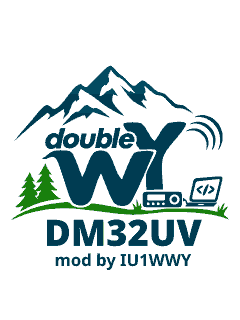
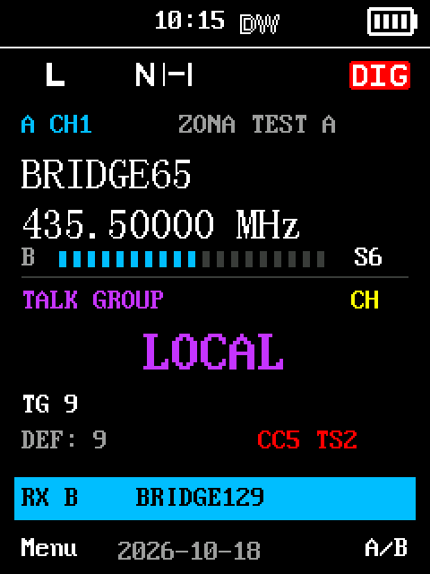
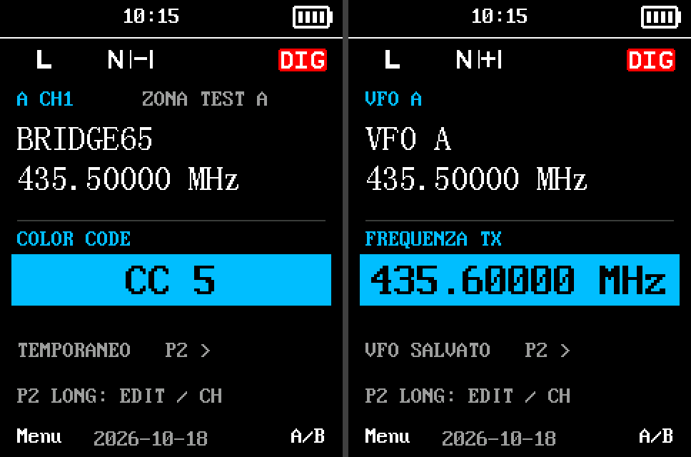
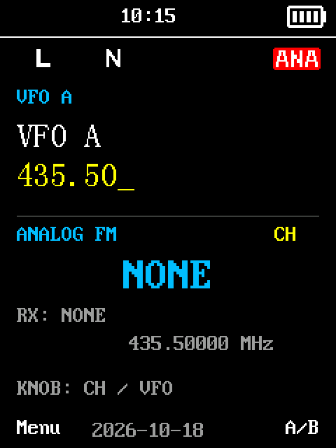
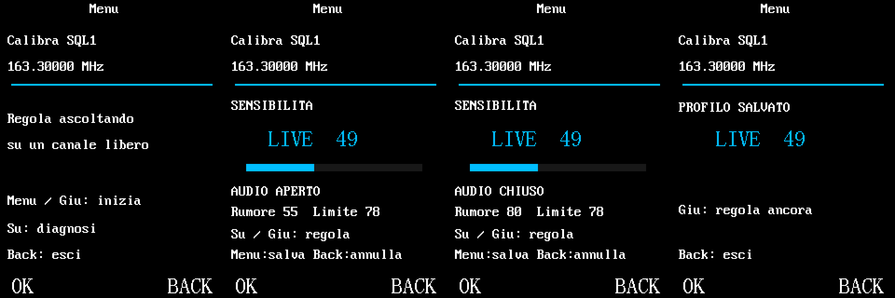
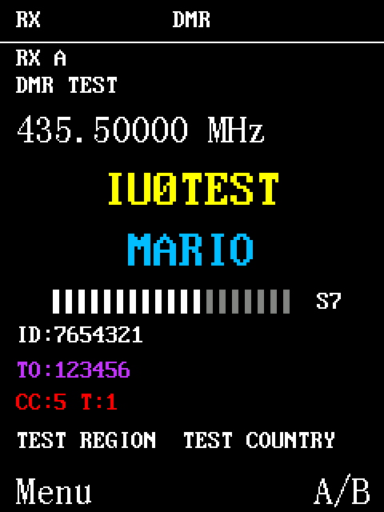
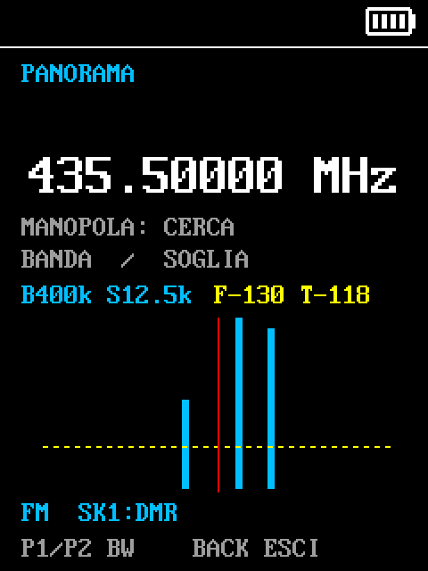
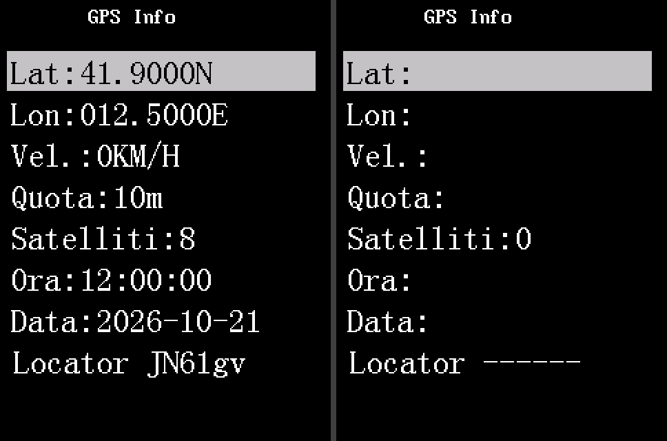
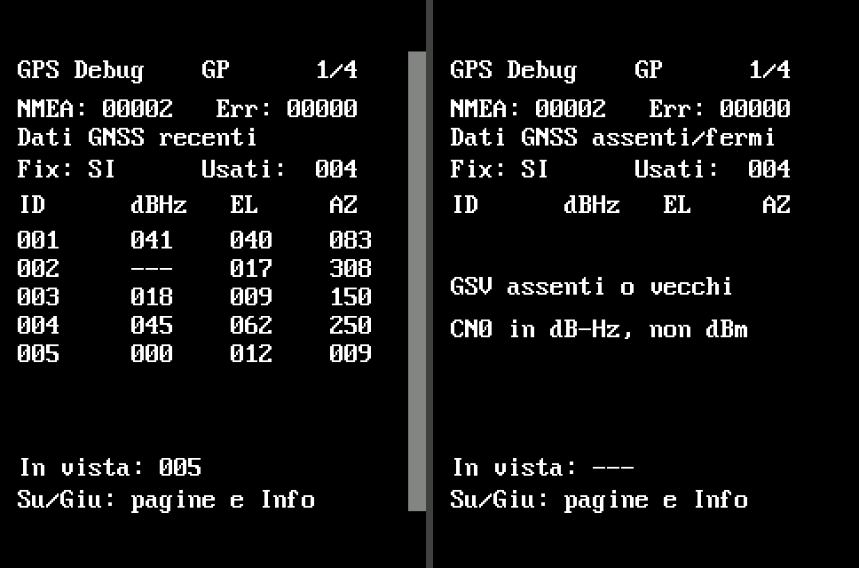
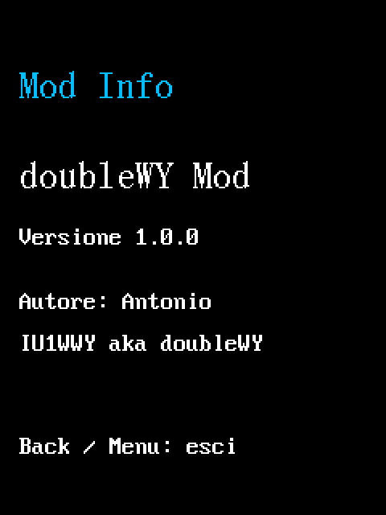

# doubleWY Mod per Baofeng DM32UV — Guida

La **doubleWY Mod** nasce da **IU1WWY**, radioamatore appassionato di
informatica, con lo scopo di migliorare il firmware originale del Baofeng
DM32UV: correggere i difetti, rendere più comodo l'uso quotidiano e
aggiungere nuove funzioni nel tempo. Non è un prodotto ufficiale Baofeng.

Questa guida descrive sempre lo stato attuale della mod. Integra il manuale OEM Baofeng DM32UV (`DM32.NRF.01.049`) e
descrive **tutte le funzioni, i miglioramenti e le correzioni** della mod. Le funzioni OEM non citate conservano il loro comportamento.
P1/P2, SK1/SK2, Su/Giù, Menu e Back indicano i tasti fisici.

Le schermate sono generate eseguendo il codice di disegno del firmware con i
font OEM e **dati fittizi** (nomi, ID, frequenze); sulla radio colori e
contenuti dipendono dal codeplug e dai segnali reali.

## Indice

1. [Avvio, tasti e retroilluminazione](#1-avvio-tasti-e-retroilluminazione)
2. [Schermata principale A/B e S-meter](#2-schermata-principale-ab-e-s-meter)
3. [Editor rapido: contatti DMR, toni, CC/TS/TX](#3-editor-rapido-contatti-dmr-toni-cctstx)
4. [Analogico/Digitale con `*` e Monitor DMR](#4-analogicodigitale-con--e-monitor-dmr)
5. [Squelch: regolazione rapida e Calibra SQL1](#5-squelch-regolazione-rapida-e-calibra-sql1)
6. [Zone, All Zones e Scan](#6-zone-all-zones-e-scan)
7. [Pagina QSO DMR](#7-pagina-qso-dmr)
8. [Panorama](#8-panorama)
9. [GPS: Info con locator e GPS Debug](#9-gps-info-con-locator-e-gps-debug)
10. [Bande e lingua](#10-bande-e-lingua)
11. [Mod Info](#11-mod-info)
12. [Correzioni incluse](#12-correzioni-incluse)
13. [Installazione e aggiornamento](#13-installazione-e-aggiornamento)

## 1. Avvio, tasti e retroilluminazione

> **In breve:** La radio si accende più in fretta, mostra il logo doubleWY e risponde ai tasti anche mentre riceve.

- **Schermata di avvio.** All'accensione compare per 1,5 secondi il logo
  doubleWY "DM32UV – mod by IU1WWY" su fondo bianco, al posto della
  schermata OEM (l'impostazione Schermo avvio non ha più effetto).
- **Avvio rapido.** Le attese fisse dell'inizializzazione OEM sono
  ridotte: prima che si accenda lo schermo passano circa 0,35 s di attese
  invece di circa 2 s. Il tempo restante dipende da bootloader e hardware.
  Nessuna impostazione da cambiare.
- **Tasti durante la ricezione.** I tasti funzionano anche mentre la radio
  riceve. Blocco tastiera e controlli OEM sulla trasmissione restano attivi.
- **Luce durante Scan.** Il timer della retroilluminazione continua a
  contare anche durante la scansione; una ricezione o un tasto la riaccendono
  come nell'OEM.

## 2. Schermata principale A/B e S-meter

> **In breve:** Una schermata principale più leggibile: cosa stai ascoltando al centro, l'altro lato in una scheda e un S-meter compatto.

- Al centro l'identità utile: nome memoria o VFO, frequenza, contatto/tono.
  L'altro lato è in una scheda compatta (nome memoria o frequenza VFO).
- La scheda azzurra **RX A/B** segnala una ricezione sull'altro lato senza
  cambiare il lato selezionato.
- **S-meter compatto S0–S9/9+** con lettera A/B: a riposo segue il lato
  selezionato; in dual, durante una ricezione, quello ascoltato; in TX e Scan
  il selezionato. La scala RSSI è indicativa, non calibrata in dBm.
- I campi si aggiornano singolarmente: niente ridisegni completi a riposo e
  niente riscritture dello S-meter con valori identici.
- Stati OEM (N, Monitor, ora/data, AM) conservati; un tono disabilitato
  appare come **NONE**.

## 3. Editor rapido: contatti DMR, toni, CC/TS/TX

> **In breve:** Con P2 lunga cambi al volo contatto DMR, tono TX, Color Code, Time Slot e frequenza TX, senza passare dal CPS.

| Comando | Azione |
| --- | --- |
| **P2 lunga** | Apre l'editor: contatto DMR oppure tono TX analogico |
| **Manopola** nell'editor | Cambia il campo evidenziato |
| **P2 breve** in DMR | Contatto → CC → TS → TX → contatto |
| **P2 breve** in analogico | Tono TX → TX → tono TX |
| **Back** | Chiude l'editor |
| **P1/P2 brevi** fuori editor | Funzioni CPS invariate, comprese le zone |

- **Contatti DMR**: ordine CPS, gruppi e privati, scelta indipendente per
  A e B. **DEF** è il contatto TX del codeplug. Un gruppo scelto entra nel
  filtro RX temporaneo (capacità OEM 32 voci); un privato no.
- **Toni TX analogici**: OFF, 50 CTCSS e 105 DCS per polarità (261 scelte).
  Cambia solo il tono **TX**; il tono RX resta quello configurato.
- **Frequenza TX**: passo 100 kHz, non cambia la RX. Parte dalla TX
  configurata, o dalla RX se manca.
- **Inserimento numerico VFO**: la frequenza digitata appare in giallo
  nella stessa grafica.

| Campo modificato | Memoria | VFO |
| --- | --- | --- |
| Contatto DMR, tono TX | Temporaneo | Temporaneo |
| CC, TS, frequenza TX | Temporanei | Salvati nel VFO |
| Tipo Analogico/Digitale con `*` | Salvato nella memoria | Salvato nel VFO |
| Monitor scelto dal campo CC | Temporaneo, condiviso fra i lati | Temporaneo, condiviso |
| SQL analogico (SK1+Su/Giù) | Salvato al rilascio | Salvato al rilascio |

Le scelte temporanee non riscrivono il codeplug e si azzerano cambiando
memoria/frequenza, con Scan, Panorama o al riavvio.

## 4. Analogico/Digitale con `*` e Monitor DMR

> **In breve:** Il tasto `*` passa da analogico a digitale; il Monitor DMR ascolta tutto il traffico senza filtri CC/TS.

- **`*` nella schermata principale** alterna Analogico/Digitale sul lato
  selezionato, una sola volta per pressione (anche lunga), e salva il tipo
  nella memoria o nel VFO. Sostituisce l'azione NOAA; se un lato era rimasto
  in NOAA, la prima pressione lo riporta alla modalità normale.
- Nel campo **CC** la manopola scorre **CC0…CC15 → MONITOR → CC0**.
  Monitor attiva l'ascolto DMR OEM che ignora CC/TS, senza cambiare quelli
  configurati; scegliere un CC numerico lo disattiva. Indicato con
  **MON CC/TS:\***.
- Portando un **VFO** in Digitale (con `*`, MR/VFO o A/B) Monitor si attiva
  per default; il tasto fisico lo spegne o riaccende e tutti gli indicatori
  restano sincronizzati. Tornando in Analogico si disattiva. Sulle memorie
  non viene attivato automaticamente.

## 5. Squelch: regolazione rapida e Calibra SQL1

> **In breve:** Squelch regolabile al volo con SK1 + Su/Giù e una taratura di SQL1 fatta ascoltando, salvata per banda.

**Regolazione rapida (analogico).** Tieni **SK1** e premi **Su/Giù** per
cambiare SQL sul lato selezionato; il livello compare in piccolo e viene
salvato una volta al rilascio, senza avviare la funzione breve SK1 Scan.
Lo squelch DMR non cambia.

**Calibra SQL1** (Menu → Calibra SQL1, icona a cursori) regola la soglia di rumore di SQL1
ascoltando su una frequenza libera, in FM, da memoria o VFO.

1. Seleziona frequenza e lato, in FM con SQL1.
2. **Menu** o **Giù** avvia la regolazione partendo dal profilo salvato
   applicabile (anche interpolato), altrimenti da 1.
3. **Su** aumenta la selettività, **Giù** la riduce; fermati quando sparisce
   il fruscio e verifica che passi la voce.
4. **Menu** salva; **Back** prima del salvataggio annulla e ripristina.
5. **Live 0 + Menu** rimuove il profilo e torna al criterio OEM (non è SQL0).
   **Su** dall'introduzione apre la diagnosi (R/N, soglie, H/S/RX) senza salvare.

Il profilo vale per banda e Wide/Narrow e può interessare frequenze vicine,
anche sull'altro lato o fra memoria e VFO. Non compare nel CPS: una
riscrittura CPS della calibrazione può cancellarlo, e tornare a un firmware
precedente non lo cancella. Durante la taratura il tono RX è escluso e il dual
watch sospeso. Le 90 soglie CPS e SQL2–9 non vengono toccate. Il valore non
è una misura in dBm. La soglia calcolata viene riusata finché il
contesto non cambia e la schermata live aggiorna solo i campi variati.

## 6. Zone, All Zones e Scan

> **In breve:** Zone numerate unite in un gruppo, una zona virtuale con tutti i canali e uno Scan più chiaro e affidabile.

**Zone unite.** Zone contigue con stesso prefisso e numero consecutivo
(es. Zona1, Zona2, Zona3) formano un unico gruppo: manopola, cambio zona e
Scan (senza lista Scan assegnata) li attraversano tutti. Nomi senza numero,
zeri iniziali, prefissi diversi o salti interrompono il gruppo. Digitazione
CH e menu Zone restano sulle zone fisiche.

**All Zones** è la prima voce del menu Zone (confermala per attivarla) e
precede le zone normali nel ciclo Zona: dalla prima zona "precedente", o
dall'ultima "successiva". Con All la manopola attraversa tutti i canali in
ordine CPS e Scan li scansiona tutti, ignorando le liste Scan; zone vuote
saltate, canali duplicati ripetuti. La scelta è indipendente per A/B e vale
per la sessione. Confermando una zona fisica dal menu si esce da All.

**Scan memorie**
- Durante la ricerca compare **SCAN + nome zona** (o **SCAN All Zones**) con
  l'icona Scan; in ricezione il canale ricevuto.
- **Back** su una ricezione ferma Scan su quella memoria.
- **Nuisance Delete** esclude il canale (in tutte le zone in cui compare) e
  torna subito alla vista di ricerca. Massimo 11 ID distinti per sessione di
  Scan gruppo/All; la dodicesima esclusione è rifiutata.
- **Tono RX**: con Monitor spento, se la memoria ha CTCSS/DCS in RX,
  l'audio segue il decoder del tono. Può restare una breve sosta su una
  portante.
- In All Zones la ricerca conserva la zona corrente invece di ripartire ogni
  volta dalla prima.

**Scan VFO**
- Usa range e passo OEM del VFO selezionato; titolo VFO A/B con frequenza
  aggiornata a ogni passo e icona Scan.
- L'ascolto dell'altro lato è sospeso durante la scansione e ripristinato
  allo stop; nessun salvataggio. **Back** rimuove subito l'icona.

## 7. Pagina QSO DMR

> **In breve:** Durante un QSO DMR vedi in grande nominativo e nome di chi trasmette, con ID, destinazione e paese.

- Nominativo (giallo) e nome (azzurro) grandi; destinazione **TO** viola,
  **CC/TS** rossi; ID DMR sempre visibile; canale/zona e frequenza restano.
- L'identità viene dal **database DMR**, che ha precedenza sul nome del
  contatto. Se il database non ha l'ID, usa il **Talker Alias** valido e
  abilitato (primi 15 byte, diviso al primo spazio); altrimenti solo l'ID.
- La riga in basso mostra **sempre regione/paese** dal database; è
  vuota se l'ID non è nel database.
- Dati mancanti non vengono inventati; testi lunghi o non ASCII possono
  usare il font OEM piccolo.

## 8. Panorama

> **In breve:** Un analizzatore di spettro sul VFO: vedi i segnali attorno alla frequenza, li cerchi con la manopola e li ascolti.

Apri **Menu → Panorama** (icona a barre). Usa il VFO selezionato, anche
partendo dal dual, e sospende l'altro lato fino all'uscita. Se il lato
selezionato è in memoria la voce non compare nel menu: passa prima in VFO.

| Comando | Azione |
| --- | --- |
| **P1 / P2** | Restringe / allarga l'ampiezza BW |
| **Su / Giù** | Abbassa / alza fondo e soglia, passo 1 dB |
| **Manopola** | Cerca il prossimo segnale sopra soglia, verifica il picco e ascolta |
| **Scatto oltre il bordo** | Pagina adiacente (centro ± BW) |
| **SK2** | Cerca/ascolta oppure riprende la passata |
| **SK1 breve** | Alterna FM e DMR (Monitor OEM temporaneo) |
| **Back** | Esce, ripristina il contesto e salva nel VFO la frequenza indicata |

- 33 colonne; allargando BW ogni colonna somma più punti. Raster 7,5 kHz
  VHF e 12,5 kHz UHF; ampiezza massima 30,72 MHz VHF o 51,2 MHz UHF, nei
  limiti di banda.
- La linea tratteggiata **T = F + 12 dB** è la soglia audio: se il picco è
  sotto, abbassala con Su. La ricerca è muta in FM; l'ascolto usa il modo scelto.
- In DMR si usa il Monitor OEM (ascolto senza filtro CC/TS).
- Back ripristina FM/DMR, Monitor e dual; salva solo la frequenza, con offset
  TX OEM. Un'uscita forzata (cambio contesto, TX) non salva. Menu e altri
  tasti configurati sono ignorati mentre il grafico è attivo.

## 9. GPS: Info con locator e GPS Debug

> **In breve:** GPS Info mostra anche il locator Maidenhead; GPS Debug spiega cosa riceve il modulo GPS, satellite per satellite.

**GPS Info** mostra la riga **Locator** Maidenhead a sei caratteri (es.
`JN61gv`) calcolata dalla posizione; senza fix `------`. La pagina si
aggiorna da sola all'arrivo dei dati. Nessuna
impostazione salvata.

Da GPS Info premi **Su o Giù** per **GPS Debug**. Su/Giù scorrono
GP1..4, BDS1..4, GN1..4 e tornano a Info; Su da GP1 torna a Info; Back come OEM.

- **GP**, **BDS**, **GN**: messaggi GSV GPS, BeiDou e misti. GN può ripetere
  satelliti delle altre: non sommare i totali.
- Ogni gruppo: 4 pagine × 8 righe = 32 posizioni dell'elenco (non ID 1–32).

| Colonna | Significato |
| --- | --- |
| ID | Identificativo del satellite dal modulo |
| dBHz | C/N0, qualità del segnale in dB-Hz; non dBm, non precisione |
| EL | Elevazione: 0° orizzonte, 90° zenit |
| AZ | Azimut dal nord: 0° N, 90° E, 180° S, 270° O |

`---` = dato non disponibile (non zero).

- **NMEA**: messaggi con checksum valido; **Err**: checksum errati o GSV
  rifiutati. Contatori di questa accensione, modulo 65536.
- **Dati recenti / assenti-fermi**: arrivo di dati dal modulo, non potenza RF.
- **Fix SI/NO** e **Usati**: valori OEM; possono restare vecchi se il flusso
  si ferma. **In vista**: totale del gruppo corrente. **Parziale**: ciclo
  GSV incompleto. I dati vecchi sono nascosti.
- Mentre GPS Debug è aperto viene chiesto temporaneamente l'invio GSV; non
  salva configurazioni e non resetta il ricevitore.

Interpretazione: NMEA che cresce indica che arrivano messaggi, non che c'è un
fix. NMEA che cresce senza GSV può dipendere dal modulo, non prova un guasto
d'antenna. Satelliti con C/N0 e Fix NO: segnali presenti, posizione non
ancora valida. Err che cresce: messaggi corrotti o rifiutati.

## 10. Bande e lingua

> **In breve:** Bande di ricezione e trasmissione disponibili e menu completamente in italiano o in inglese.

- RX 136–174 e 400–480 MHz, AM 108–136 MHz; TX 136–174 e 400–480 MHz.
  Limiti applicati in RAM, calibrazioni intatte; prestazioni ai bordi non
  misurate. La radio FM broadcast è invariata.
- **Lingua italiana.** Nel menu lingua le voci sono **Italiano** ed
  **English** (**Italian** se il menu è in inglese): l'italiano sostituisce il cinese dell'OEM in menu,
  impostazioni, messaggi e pagine come GPS Info. Testi senza accenti, alcune
  voci abbreviate per stare nello spazio del display.
- Con **English** menu OEM e nuove etichette sono in inglese. Nomi di canali,
  zone, contatti e database restano quelli dell'utente.

## 11. Mod Info

> **In breve:** Una pagina del menu che mostra la versione della mod installata e l'autore.

**Menu → Mod Info** (icona "i") mostra nome e versione della mod e
l'autore: Antonio, IU1WWY aka doubleWY. **Back** o **Menu** tornano alla
schermata principale. Indica sempre la versione installata: utile per
verificare un aggiornamento.

## 12. Correzioni incluse

> **In breve:** I difetti del firmware originale che la mod corregge.

| Problema | Correzione |
| --- | --- |
| Tasti ignorati durante la ricezione | Tasti attivi in RX |
| Luce sempre accesa durante Scan | Timer luce attivo anche in Scan |
| Nome canale assente durante RX DMR | Nome del canale ricevuto mostrato |
| Scan zona limitata | Zone fino a 64 posizioni, zone unite, All Zones |
| Scritta di ricerca non ripristinata dopo Nuisance Delete | Ripristino immediato |
| Display Scan VFO fermo, icona rimasta dopo Back | Frequenza seguita, icona rimossa |
| Altro lato A/B che alterava lo Scan VFO | Sospeso durante lo Scan, ripristinato allo stop |
| Canale iniziale a 0 MHz fino al primo scatto | Caricamento corretto all'avvio |
| Contesto memoria/VFO errato nella calibrazione | A/B e contesto ricalcolati |
| Ridisegni S-meter identici (possibile ticchettio) | Disegno solo se cambia |
| GPS Info non aggiornata in automatico | Aggiornamento automatico ripristinato |
| Tono RX forzato aperto in Scan memorie | Decoder CTCSS/DCS OEM rispettato |
| Talker Alias al posto della regione nel QSO | Riga sempre regione/paese |
| Avvio lento | Attese fisse ridotte |
| Menu disponibili solo in cinese o inglese | Cinese sostituito dall'italiano |

## 13. Installazione e aggiornamento

> **In breve:** Lo script `doublewy_patcher.py` legge il firmware dalla tua radio, crea la mod e la installa, guidandoti passo passo. Funziona su Windows, macOS e Linux.

### Cosa serve

- Radio DM32UV con firmware **DM32.NRF.01.049** (Menu → Impostazioni → Info
  radio) oppure con una versione pubblicata della doubleWY Mod.
- Batteria carica: un'interruzione durante la scrittura lascia la radio senza
  firmware (recuperabile, ma meglio evitarla).
- Cavo di programmazione USB del DM32UV (convertitore **CH340**).
- **Python 3.8 o successivo** e il modulo **pyserial**.
- Nessun altro programma deve usare il cavo: chiudi il CPS Baofeng e le
  schede del browser con grid.radio.

### Windows

1. Scarica Python da <https://www.python.org/downloads/> e installalo
   spuntando **"Add python.exe to PATH"**.
2. Apri il **Prompt dei comandi** e installa pyserial:
   `py -m pip install pyserial`
3. Collega il cavo. In **Gestione dispositivi → Porte (COM e LPT)** deve
   comparire *USB-SERIAL CH340 (COMx)*. Se manca, installa il driver CH340 dal
   sito del produttore WCH (<https://www.wch-ic.com/downloads/CH341SER_EXE.html>)
   e ricollega il cavo.
4. Nella cartella dove hai scaricato `doublewy_patcher.py` lancia:
   `py doublewy_patcher.py`

### macOS

1. Installa Python da <https://www.python.org/downloads/macos/> (oppure con
   Homebrew: `brew install python`).
2. Nel **Terminale**: `python3 -m pip install pyserial`
3. Collega il cavo: le versioni recenti di macOS riconoscono il CH340 da sole
   e la porta si chiama `/dev/cu.usbserial-…` o `/dev/cu.wchusbserial…`. Se non
   compare, installa il driver CH34x per macOS dal sito WCH e riavvia.
4. Nella cartella dello script: `python3 doublewy_patcher.py`

### Linux

1. Python è quasi sempre già presente. Installa pyserial dal gestore pacchetti
   (`sudo apt install python3-serial`, `sudo pacman -S python-pyserial`,
   `sudo dnf install python3-pyserial`) oppure con
   `python3 -m pip install --user pyserial`.
2. Collega il cavo: la porta è `/dev/ttyUSB0`. Il tuo utente deve poterla
   usare: aggiungilo al gruppo `dialout` (Debian/Ubuntu/Fedora) o `uucp`
   (Arch), per esempio `sudo usermod -aG dialout $USER`, poi esci e rientra.
3. Nella cartella dello script: `python3 doublewy_patcher.py`

### La procedura guidata

1. **Lingua e porta.** Scegli italiano o inglese; lo script elenca le porte
   USB e propone quella del cavo CH340.
2. **Lettura (passo 1/3).** Spegni la radio, premi Invio, poi **accendila
   normalmente**. Lo schermo resta spento: la radio è nella modalità di
   avvio del processore e lo script legge tutta la memoria programma
   (1 MB, circa 2 minuti, con barra di avanzamento). Il backup viene salvato
   come `DM32UV-program-memory-DATA.bin`: **conservalo**, contiene il firmware
   originale della tua radio e serve per tornare indietro.
3. **Riconoscimento.** Lo script riconosce la 049 originale o la versione
   della mod installata e crea `doubleWY-mod-DM32UV-vX.Y.Z.bin`. Se la radio
   ha già la versione corrente te lo dice e chiede se reinstallarla.
4. **Modalità aggiornamento (passo 2/3).** Spegni la radio, tieni premuti
   **SK1** (tasto laterale) e **PTT** e accendila: il LED diventa verde.
   Rilascia i tasti e conferma con `s`.
5. **Installazione (passo 3/3).** Cancellazione (circa 15 s) e scrittura
   (circa 100 s) con barra di avanzamento. Se la radio non è in modalità
   aggiornamento lo script si ferma **prima** di cancellare qualsiasi cosa.
6. Spegni e riaccendi: compare lo splash doubleWY e Menu → Mod Info mostra la
   versione installata.

### Altri modi d'uso

- Solo creare il file, senza radio collegata:
  `python3 doublewy_patcher.py --firmware backup.bin` (accetta il backup della
  memoria programma, il file di aggiornamento 049 originale o una mod
  pubblicata). Il file si installa anche con il CPS Baofeng.
- Installare un file già creato o ripetere un'installazione interrotta:
  `python3 doublewy_patcher.py --firmware backup.bin --flash`.

### Aggiornare e tornare indietro

- **Nuova versione della mod:** scarica il nuovo `doublewy_patcher.py` e
  ripeti la procedura: riconosce la versione installata e applica solo le
  modifiche necessarie.
- **Tornare al firmware originale:** usa il backup salvato al primo utilizzo;
  dalla sua memoria programma si ricava la 049 originale, da installare con il
  CPS Baofeng o con un programma che scriva la memoria programma.
- Il bootloader non viene mai modificato. Tornare indietro non annulla i dati
  già salvati (frequenze VFO, livelli SQL, profili SQL1, tipo
  Analogico/Digitale).

### Se qualcosa va storto

- *"La radio non ha risposto"*: la radio va accesa **dopo** aver premuto
  Invio; controlla porta e cavo e che nessun altro programma lo usi.
- *"Non è in modalità aggiornamento"*: rifai SK1 + PTT all'accensione, LED
  verde. Nulla è stato modificato.
- Errore durante la scrittura: rimetti la radio in modalità aggiornamento e
  lancia il comando che lo script ti indica: il bootloader è intatto.
